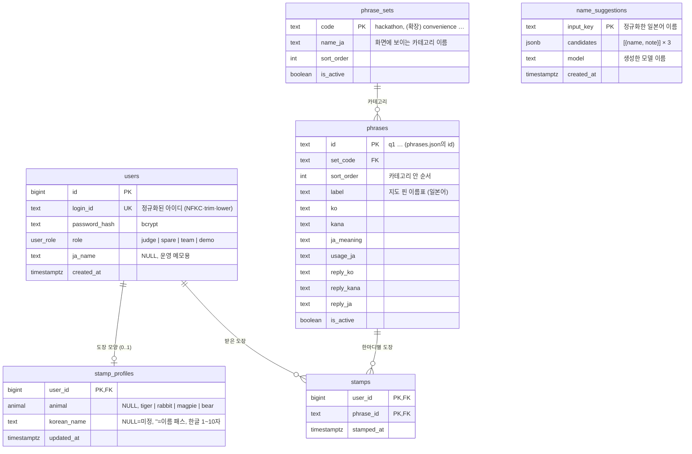

# ERD · 데이터 모델

> 상태: 설계 (구현 전) · 작성 2026-11-27 · 담당 태원
> 결정 배경: [ADR-002](../adr/ADR-002-data-model.md) 데이터 모델 · [ADR-003](../adr/ADR-003-phrase-sets-and-api.md) 한마디 카테고리 · [ADR-004](../adr/ADR-004-llm-name-suggestions.md) LLM 이름 추천

## 1. 다이어그램



`name_suggestions`는 LLM 응답 캐시라 다른 테이블과 관계가 없다(누가 요청했는지 남기지 않는다).

## 2. 테이블 정의

### `users`: 미리 발급한 계정

| 컬럼 | 타입 | 제약 | 설명 |
|---|---|---|---|
| `id` | `BIGINT` | PK, identity | 내부 id. JWT `sub` |
| `login_id` | `TEXT` | NOT NULL, UNIQUE | 정규화된 값(NFKC → trim → 소문자). API에서는 `account_id` |
| `password_hash` | `TEXT` | NOT NULL | bcrypt |
| `role` | `user_role` | NOT NULL | 통계(P2)에서 `judge`·`spare`만 센다 |
| `ja_name` | `TEXT` | NULL | 운영 메모. API로 내보내지 않는다 |
| `created_at` | `TIMESTAMPTZ` | NOT NULL, default `now()` | |

### `stamp_profiles`: 내 도장 모양

| 컬럼 | 타입 | 제약 | 설명 |
|---|---|---|---|
| `user_id` | `BIGINT` | PK, FK → `users.id` ON DELETE CASCADE | 사용자당 하나 |
| `animal` | `animal` | NULL | |
| `korean_name` | `TEXT` | NULL, `CHECK (korean_name = '' OR korean_name ~ '^[가-힣]{1,10}$')` | 추천 후보 중 고른 이름 |
| `updated_at` | `TIMESTAMPTZ` | NOT NULL, default `now()` | |

- 행이 없으면 둘 다 NULL로 본다. 첫 `PUT /api/me/profile` 때 upsert.
- `korean_name`의 세 가지 상태 (FE `Profile.koreanName`과 같음):

| 값 | 뜻 | FE 화면 |
|---|---|---|
| `NULL` | 아직 안 정함 | 설정 화면 |
| `''` (빈 문자열) | 이름을 패스함, 동물만 있는 도장 | 한마디판 |
| 한글 1~10자 | 고른 이름 | 한마디판 |

### `phrase_sets`: 한마디 카테고리 (확장용)

| 컬럼 | 타입 | 제약 | 설명 |
|---|---|---|---|
| `code` | `TEXT` | PK, `CHECK (code ~ '^[a-z][a-z0-9_]{0,31}$')` | API·URL에 쓰는 코드 |
| `name_ja` | `TEXT` | NOT NULL | 카테고리 이름 (일본어, 예: `ハッカソン会場`) |
| `sort_order` | `INT` | NOT NULL | 목록 순서 |
| `is_active` | `BOOLEAN` | NOT NULL, default `true` | |

- 지금은 `hackathon` 하나만 시드한다. 편의점·화장실·일상 회화 같은 카테고리는 **보류**(검수된 문장이 준비되면 행만 추가).
- 원본은 `content/phrase_sets.json`(새 파일, FE는 읽지 않음).

### `phrases`: 한마디 (`content/phrases.json`의 시드 사본)

| 컬럼 | 타입 | 제약 | `phrases.json` 필드 |
|---|---|---|---|
| `id` | `TEXT` | PK | `id` (카테고리가 달라도 전체에서 유일) |
| `set_code` | `TEXT` | NOT NULL, FK → `phrase_sets.code` | `set` (없으면 `hackathon`) |
| `sort_order` | `INT` | NOT NULL | 같은 카테고리 안의 배열 순서 |
| `label` | `TEXT` | NOT NULL | `label` (지도 핀에 붙는 짧은 이름표, 일본어) |
| `ko` | `TEXT` | NOT NULL | `ko` |
| `kana` | `TEXT` | NOT NULL | `kana` |
| `ja_meaning` | `TEXT` | NOT NULL | `ja` |
| `usage_ja` | `TEXT` | NOT NULL | `when` |
| `reply_ko` | `TEXT` | NOT NULL | `reply` |
| `reply_kana` | `TEXT` | NOT NULL | `replyKana` |
| `reply_ja` | `TEXT` | NOT NULL | `replyJa` |
| `is_active` | `BOOLEAN` | NOT NULL, default `true` | 파일에서 빠지면 `false` |

- 제약: `UNIQUE (set_code, sort_order)`.
- 행을 지우지 않는다(도장이 FK로 가리킴).
- 지금 `phrases.json`은 바꾸지 않는다. `set` 필드가 없으면 시드가 `hackathon`으로 넣는다. 카테고리가 생기면 항목마다 `"set": "convenience"`처럼 필드를 더한다. 필드 추가라 FE 번들은 깨지지 않는다.

### `stamps`: 받은 도장

| 컬럼 | 타입 | 제약 | 설명 |
|---|---|---|---|
| `user_id` | `BIGINT` | PK, FK → `users.id` ON DELETE CASCADE | |
| `phrase_id` | `TEXT` | PK, FK → `phrases.id` | |
| `stamped_at` | `TIMESTAMPTZ` | NOT NULL, default `now()` | 처음 받은 시각. 다시 보내도 바뀌지 않는다 |

- PK `(user_id, phrase_id)`: 한마디당 도장 하나. 카테고리는 `phrases.set_code`로 따라간다(도장에 중복 저장하지 않음).

### `name_suggestions`: LLM 이름 추천 캐시

| 컬럼 | 타입 | 제약 | 설명 |
|---|---|---|---|
| `input_key` | `TEXT` | PK | 일본어 이름(성+이름 전체) 정규화 값: NFKC → trim → 연속 공백을 반각 공백 하나로 |
| `candidates` | `JSONB` | NOT NULL | 검증을 통과한 후보 3개 `[{"name","note"}]` (FE `NameCandidate`와 같은 모양) |
| `model` | `TEXT` | NOT NULL | 예: `gemini-…-flash`. 모델을 바꾸면 어떤 결과인지 알 수 있게 |
| `created_at` | `TIMESTAMPTZ` | NOT NULL, default `now()` | |

- 같은 이름은 같은 후보가 나온다(두 번째부터 LLM을 부르지 않음).
- 검증에 실패한 응답이나 오류는 저장하지 않는다.
- 일본어 이름은 개인 정보라 `scripts/reset.py --names`로 비울 수 있게 한다.

## 3. 열거형

| 타입 | 값 | 쓰는 곳 |
|---|---|---|
| `user_role` | `judge`, `spare`, `team`, `demo` | `users.role` |
| `animal` | `tiger`, `rabbit`, `magpie`, `bear` | `stamp_profiles.animal` (FE `Animal`과 같음) |

## 4. 파생 값

진행도는 **카테고리별**이다.

| 값 | 계산 (카테고리 `s`마다) |
|---|---|
| `total` | `s`의 활성 한마디 수 |
| `count` | 내 도장 중 `s`의 활성 한마디 수 |
| `completed` | `total > 0 AND count = total` |

- 응답의 `progress`는 활성 카테고리 전부를 `phrase_sets.sort_order` 순서로 담는다(도장이 0개인 카테고리도 포함).
- 도장 목록은 활성 한마디의 도장만, `stamped_at` 오름차순.

## 5. 보류 중인 테이블

### `attempts` (H-2)

```
attempts (id BIGINT PK, user_id FK, phrase_id FK, result attempt_result, created_at TIMESTAMPTZ)
attempt_result: understood | retry
```

## 6. 초안(backend/CLAUDE.md 첫 버전)과 달라진 점

| 초안 | 이번 설계 | 근거 |
|---|---|---|
| `seals` | `stamp_profiles` | ADR-002 |
| `seals.name_pool_id`, `style`, `name_pool` | 삭제, 대신 `name_suggestions`(LLM 캐시) | ADR-002, ADR-004 |
| `stamps.collected_at` | `stamps.stamped_at` | ADR-002 |
| `phrases.set_code` (자유 문자열) | `phrases.set_code` FK → `phrase_sets` | ADR-003 |
| `phrases.id` 정수 가능성 | `TEXT` (`q1`…) | ADR-002 |
| (없음) | `phrases.label` | FE PR #2에서 `phrases.json`에 추가됨 |
| `korean_name` NULL 또는 이름 | `''`(이름 패스)도 허용 | FE PR #2, ADR-002 |
| `attempts` | 보류 | ADR-001 H-2 |
| 뷰 `phrase_stats`, `event_stats` | P2 때 | 범위 밖 |
